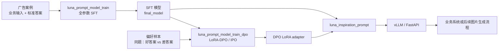
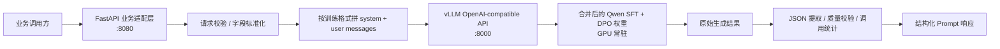

## 先说结论

`luna_prompt_model_train`、`luna_prompt_model_train_dpo` 和 `luna_inspiration_prompt` 是同一项工作的三个阶段：把通用的 Qwen3-8B 训练并交付为一个可被广告业务调用的“广告图片创意 Prompt 生成器”。

业务输入是品牌、行业、营销目标、推广主体、品牌描述、语言和风格偏好；模型输出是一段结构化的广告图片 Prompt，描述视觉风格、画面主体、场景构图、营销文案和 CTA。它是图片生成模型的上游创意大脑，不直接生成图片。



- SFT 让模型先“会做题”：能读懂广告需求并给出规范的广告创意结果。
- DPO/IPO 让模型再“知道什么答案更好”：相同需求下更偏向优质答案，避开劣质答案。
- `luna_inspiration_prompt` 不参与训练：它把 SFT 模型与 DPO adapter 变成线上可调用的 API。

## 1. 为什么需要这套模型

广告图片创意不是只输入产品名就够了。一个合格的 Prompt 必须同时把业务信息转成视觉决策：

| 业务输入 | 模型要完成的事 |
| --- | --- |
| 品牌、行业 | 理解品牌调性、受众和行业表达 |
| 营销目标 | 识别拉新、促销、曝光、新品推广等，决定情绪与 CTA |
| 推广主体 | 确保产品/服务是视觉核心，不跑题 |
| 品牌描述、偏好 | 决定风格、色彩、场景、构图和表达方式 |
| 输出语言 | 生成适合目标市场的文案 |
| 业务限制 | 遵守 JSON 结构、必填字段与安全/品牌规则 |

通用大模型能写文字，但不保证稳定符合广告业务格式，也不一定能在“多个看起来都合理的答案”中始终选中业务偏好的那一个。因此项目将能力拆为两步训练，再通过服务交付。

## 2. 三个项目各自负责什么

| 项目 | 链路位置 | 核心职责 | 输入 | 产物 |
| --- | --- | --- | --- |
| `luna_prompt_model_train` | 第一步 | 全参数 SFT，让 Qwen 学会广告创意任务与输出格式 | `system/user/assistant` 三轮对话 | 完整 SFT 模型和 tokenizer |
| `luna_prompt_model_train_dpo` | 第二步 | LoRA-DPO / IPO，用偏好对优化“好答案优先” | `prompt/chosen/rejected` | LoRA adapter 与评估结果 |
| `luna_inspiration_prompt` | 第三步 | 加载/合并上述模型，提供 REST API 和 vLLM 推理 | 业务 JSON 请求 | 业务可调用的广告 Prompt 服务 |

它们不是三个互相竞争的项目，而是一条连续资产链：

```text
标准广告案例 → SFT 完整模型 → DPO 偏好 adapter → 合并模型/在线 API
```

## 3. 基础模型：实际使用的 Qwen 是什么

### 3.1 可确认的模型身份

训练配置和对比代码声明的基础模型是：

```text
Qwen/Qwen3-8B
```

也就是说项目目标是 **Qwen3-8B**，不是 `Qwen3-8B-Base`，也不是 Qwen2.5。SFT 配置优先使用本地目录 `/data/steven/model/Qwen/Qwen3-8B`；只有该本地路径为空时才会回退到 Hugging Face ID。因此，“项目声明的模型 ID”与“历史某次训练实际加载的本地权重快照”不能混为一谈。

根据 Qwen 官方模型卡，Qwen3-8B 的关键规格为：

| 项目 | 规格 |
| --- | --- |
| 架构 | Causal Language Model，Qwen3ForCausalLM |
| 总参数量 | **8.2B** |
| 非 embedding 参数 | **6.95B** |
| 层数 | 36 |
| Attention | GQA，32 个 Query heads、8 个 KV heads |
| 原生训练上下文 | **32,768 tokens** |
| 可扩展上下文 | YaRN 下最高 131,072 tokens |

来源：[Qwen/Qwen3-8B 官方模型卡](https://huggingface.co/Qwen/Qwen3-8B)，[Qwen 官方长上下文说明](https://github.com/QwenLM/Qwen3/blob/main/docs/source/deployment/vllm.md)。

公开 `config.json` 的 `max_position_embeddings` 为 40,960；官方说明这是服务端预留输入/输出时的默认设置，不应与原生训练上下文 32,768 混淆。[Qwen3-8B config.json](https://huggingface.co/Qwen/Qwen3-8B/blob/main/config.json)

### 3.2 基座能力不等于本项目的训练长度

本项目 SFT 与 DPO 的 `max_seq_length` 都是 **4,096 tokens**。这表示：

- 基座理论上可支持约 32K 的原生上下文；
- 本项目单条训练样本最多只用到 4K；
- 推理中的 `max_new_tokens: 4096` 是输出上限，不是上下文上限；
- 当前训练并没有使用 Qwen3 的长上下文能力。

这是显存与成本的选择，而不是模型能力缺失。对广告 Prompt 而言 4K 通常足够，但系统提示词很长时，仍必须控制“输入 token + 输出 token”的总长度。

### 3.3 模型和 tokenizer 的 commit/hash：当前事实

当前无法诚实地给出“实际训练权重”和 tokenizer 的确切 commit/hash，原因是训练脚本没有将这些版本钉死或自动记录：

| 资产 | 当前可确认的信息 | 当前无法确认的信息 |
| --- | --- | --- |
| 基础模型 | 声明 ID：`Qwen/Qwen3-8B` | 本地模型目录对应的 Hugging Face revision/commit |
| tokenizer | 从同一模型路径用 `AutoTokenizer.from_pretrained()` 加载 | `tokenizer.json` / chat template / tokenizer config 的 SHA256 |
| SFT 模型 | 设计上导出到 `models/final_model` | 当前工作区没有该目录和权重文件，无法计算 hash |
| DPO adapter | 设计上导出到 `models/dpo_model` | 当前工作区没有 adapter 权重与 `adapter_config.json`，无法计算 hash |

`from_pretrained()` 没有传 `revision=`，本地权重也未纳入 Git。因此，不能把 Hugging Face 今天的 `main` commit 误写为过去训练实际使用的 commit。

当前可追溯的是代码版本：

| 仓库 | Git HEAD |
| --- | --- |
| `luna_prompt_model_train` | `5c7863dcd2a09a0f184e01f513069921b466a5fe` |
| `luna_prompt_model_train_dpo` | `6a2459d45ba4cdd545449954e0332344bbc21108` |
| `luna_inspiration_prompt` | `84fac177a5450caff20cf8033a6a965fe7f12248` |

未来每个模型版本都应登记：模型 ID、HF revision、`config.json` / `tokenizer.json` / `tokenizer_config.json` SHA256、SFT 权重 manifest、adapter hash、代码 Git SHA、数据 hash 和训练配置快照。

### 3.4 SFT 实际加载的权重与 tokenizer 配置

这一部分以 `luna_prompt_model_train/config/config.yaml` 与 `train/train_sft.py` 的代码为准，而不是根据模型名称推测。

#### 训练的模型权重是什么？

SFT 配置指定：

```yaml
model:
  name: "Qwen3-8B"
  local_path: "/data/steven/model/Qwen/Qwen3-8B"
  torch_dtype: "bfloat16"
  device: "auto"
  trust_remote_code: true
  gradient_checkpointing: true
  load_in_8bit: false
  load_in_4bit: false
```

训练脚本实际执行的等价逻辑是：

```python
model_id = "/data/steven/model/Qwen/Qwen3-8B"
model = AutoModelForCausalLM.from_pretrained(
    model_id,
    torch_dtype=torch.bfloat16,
    device_map="auto",
    trust_remote_code=True,
)
model.gradient_checkpointing_enable()
```

因此，SFT 起点是本地目录中的 **Qwen3-8B Base 全量权重**，以 BF16 加载；训练中所有 `requires_grad=True` 的参数都会参与更新，即**全参数 SFT，不是 LoRA、QLoRA 或 8/4-bit 量化训练**。训练完成后会同时保存模型权重与 tokenizer 到 `models/final_model`。

需要严谨地区分三件事：

| 项目 | 可确认事实 | 不可确认事实 |
| --- | --- | --- |
| 逻辑模型来源 | 配置声明为 `Qwen/Qwen3-8B`，实际优先加载本地 `/data/steven/model/Qwen/Qwen3-8B` | 该本地目录对应 HF 的具体 revision/commit |
| 实际训练权重 | 本地 Qwen3-8B 的全量 BF16 权重作为初始化 | 原始 `*.safetensors` 文件名、分片数量、SHA256；目录未提交到当前仓库 |
| SFT 产物 | 设计输出为 `models/final_model` | 当前工作区无该权重目录，无法读取其 `config.json` 或计算 hash |

配置文件里 `hf_model_id: "Qwen/Qwen3-8B"` 是注释状态；因为 `local_path` 非空，脚本实际走本地路径。若本地路径不存在，当前配置并不能直接正常回退：脚本会读取未定义的 `hf_model_id` 字段。因此正式训练/发布前应把 `hf_model_id` 恢复为有效配置，并显式写入 `revision`。

#### Tokenizer 是什么、如何配置？

Tokenizer 不是单独指定的模型，而是与上述**同一个 `model_id` / 同一目录**加载：

```python
tokenizer = AutoTokenizer.from_pretrained(
    "/data/steven/model/Qwen/Qwen3-8B",
    trust_remote_code=True,
)

if tokenizer.pad_token is None:
    tokenizer.pad_token = tokenizer.eos_token
```

所以它应是该本地 Qwen3-8B 权重目录随附的 Qwen tokenizer、词表、special tokens 与 chat template；项目没有换用 BERT、SentencePiece 或另一个 tokenizer。脚本没有显式传入 `revision`、`use_fast`、`padding_side`、`eos_token_id`、`bos_token_id`、额外 special token 或自定义 `chat_template`，这些值均继承本地 tokenizer 文件的默认定义，当前不能凭代码给出具体 token ID 或词表大小。

训练时的 tokenizer 行为是：

| 配置项 | 实际值 | 含义 |
| --- | --- | --- |
| 对话模板 | `tokenizer.apply_chat_template(messages, tokenize=False, add_generation_prompt=False)` | 使用 Qwen tokenizer 自带 chat template 拼接 system/user/assistant；训练样本末尾不额外添加空 assistant generation prompt |
| 最大长度 | `4096` | system + user + assistant 的总 token 数上限，不是仅 assistant 输出上限 |
| 超长处理 | `truncation=True` | 超过 4096 的序列会被截断；当前代码未指定 `truncation_side`，继承 tokenizer 默认值 |
| padding | `padding="max_length"` | 每条样本先补齐到 4096 token，便于固定 shape 训练 |
| pad token | 若原 tokenizer 未定义，则设为 `eos_token` | 避免 batch padding 报错；若原 tokenizer 已定义，则保持原值 |
| labels | `labels = input_ids.copy()` | 当前实现对完整 chat 序列计算语言模型损失，并非只 mask 后计算 assistant 答案 |

最后一项是重要实现细节：当前代码在 padding 后直接复制 `input_ids` 为 `labels`，未将 padding token 改成 Hugging Face 忽略标签 `-100`；同时也没有 mask system/user token。因此 loss 会覆盖整段对话，且可能覆盖 pad/eos 位。它解释了该 SFT 的真实优化目标，但若要做更标准的 answer-only SFT，应基于 assistant token 区间构造 labels，并将 padding 位设为 `-100` 后重新验证训练与评估指标。

## 4. SFT：让模型学会生成广告创意 Prompt

### 4.1 数据来自哪里？标注是什么？

SFT 原始数据配置指向上游 `luna_prompt_model`：

```text
../luna_prompt_model/data/training/training_data_2025_12_14.jsonl
```

当前项目内还保存了转换后的数据快照：训练集 9,162 条、验证集 2,291 条、固定生成评测集 50 条；处理统计记录总样本为 11,453 条。

每条 SFT 数据是一道“有标准答案的题”：

```json
{
  "messages": [
    {"role": "system", "content": "广告创意规则、输出格式与合规限制"},
    {"role": "user", "content": "品牌、行业、目标、主体、偏好等需求"},
    {"role": "assistant", "content": "<thinking>分析</thinking> + JSON 广告 Prompt"}
  ]
}
```

这里的 `assistant.content` 就是 SFT 的标注答案（ground truth / golden answer）。它不是传统分类任务中的 `label=1`，而是模型要模仿生成的完整目标文本。

`train/data_transform.py` 不产生标注；它只验证三轮角色结构、检查 thinking 和 JSON、清理多余 thinking 块并切分训练/验证集。当前仓库能证明每条样本有 assistant 标准答案，但无法只凭现有文件证明每条答案是人工写作、Gemini 生成后审核，还是其他上游流程产出。要追溯标注人员、审核规则和版本，必须查看上游 `luna_prompt_model` 的数据生产记录。

### 4.2 SFT 在学什么

SFT 是全参数监督微调：Qwen3-8B 的全部可训练权重参与更新。它用 next-token cross-entropy 最小化“模型生成的 token”与“assistant 标准答案 token”之间的差异。

从业务角度，模型学习的维度包括：

| 维度 | 学习内容 |
| --- | --- |
| 需求理解 | 品牌、行业、语言、营销目标、主体、品牌描述与偏好之间的关系 |
| 创意规划 | 视觉风格、主体、场景、构图、光影、氛围、文案、CTA 的组合 |
| 结构化输出 | JSON 数组、`product`、`prompt` 等字段和段落组织 |
| 格式遵从 | thinking、JSON、必填字段与顺序 |
| 合规 | system prompt 中定义的禁用内容、品牌和视觉限制 |
| 本地化 | 按用户要求的语言组织广告描述和文案 |

实现上，训练脚本把 system、user、assistant 拼成完整 chat template，然后将整段 token 都作为 `labels`。所以当前损失不只计算 assistant 答案，也计算 system/user token；它不是 answer-only SFT。这个选择会使模型学习整个对话分布，但会增加长系统提示词对训练 token 的占比。

当前默认训练为 5 epoch、每卡 batch 2、梯度累积 8、最大序列 4,096、学习率 `5e-6`、BF16 和梯度检查点。关键点是：**SFT 更新完整的 8.2B 基座，不是小插件。**它适应领域的能力强，但显存成本和过拟合风险更高。

## 5. DPO / IPO：让模型偏向“更好的答案”

### 5.1 偏好数据的含义

DPO 的每条数据是一道题下的答案对比：

```json
{
  "prompt": [{"role": "system", "content": "规则"}, {"role": "user", "content": "广告需求"}],
  "chosen": "被认为更好的回答",
  "rejected": "被认为较差的回答"
}
```

SFT 告诉模型“标准答案长什么样”；DPO 告诉模型“在这两个答案中，哪个更符合业务偏好”。它适合学习无法简单拆成唯一文本标准的目标：创意是否具体、营销目标是否突出、画面能否落地、格式是否干净、风格是否贴近品牌。

当前 `dpo_training_data.jsonl` 只有 14 对。按默认 80/20 切分，实际约 11 条训练、3 条验证。这只能用于流程验证或探索性实验，不能支持稳健泛化或“质量很高”的结论；小数据 DPO 很容易记住训练对。

### 5.2 DPO 算法做了什么

DPO 不需要另训一个奖励模型。它比较：

- **policy model**：正在训练的、带 LoRA 的 SFT 模型；
- **reference model**：冻结的原始 SFT 模型；
- **chosen / rejected**：同一输入下的好答案和差答案。

直觉是：相对 reference，policy 要提高 chosen 的概率，并降低 rejected 的概率。标准 DPO 目标可写为：

```text
L = -log sigmoid(β × [
 log πpolicy(chosen|prompt) - log πref(chosen|prompt)
 - log πpolicy(rejected|prompt) + log πref(rejected|prompt)
])
```

β 控制偏好信号强度。当前 sigmoid DPO 配置使用 `beta=0.3`、1 epoch、学习率 `1e-5`。项目也提供 IPO 配置：`loss_type=ipo`、`beta=1.0`、3 epoch、学习率 `5e-6`。两种 loss 中 β 的语义不同，不能横向直接比较。

### 5.3 LoRA adapter 的 rank / alpha

DPO 不更新全部 8.2B 权重，而是在若干线性层旁增加低秩可训练矩阵。SFT 本体冻结，只训练 adapter。

| 配置 | 当前值 | 含义 |
| --- | ---: | --- |
| `r`（rank） | **16** | LoRA 的低秩维度；越大容量越高，也更耗显存且更易过拟合 |
| `alpha` | **32** | LoRA 缩放系数；当前 `alpha/r = 2` |
| dropout | 0.05 | LoRA 支路的正则化 |
| bias | `none` | 不训练 bias |
| 目标模块 | q/k/v/o proj + gate/up/down proj | 覆盖 attention 与 MLP |

按 Qwen3-8B 的 36 层、hidden size 4,096、intermediate size 12,288、8 KV heads及当前模块列表推导，LoRA 权重约为 **43.65M 参数**，约为 8.2B 总参数的 **0.53%**。这是设计计算值；实际值应以最终 adapter 的权重和 `adapter_config.json` 为准。

两阶段的分工因此非常清楚：全参 SFT 学“广告领域语言、任务格式与基础能力”；LoRA-DPO 学“业务更喜欢什么样的输出”。

要注意：IPO 配置注释提到 reference-free 的设想，但当前 `train.py` 仍无条件加载 `ref_model` 并传入 `DPOTrainer`。实际显存规划仍应按 policy + reference 两份模型考虑。

## 6. 训练维度：它到底优化了哪些东西

| 层次 | SFT | DPO / IPO |
| --- | --- | --- |
| 输入 | 品牌、行业、语言、营销目标、主体、品牌描述、偏好 + system rule | 相同的业务输入 |
| 输出 | 视觉风格、创意主体、场景描述、营销文案、CTA、JSON、thinking | chosen 相对 rejected 的整体偏好 |
| 参数 | 全部 8.2B 基座权重 | 约 43.65M LoRA 权重，基础模型冻结 |
| 直接优化信号 | token 预测误差 | 好答案相对差答案的概率偏好 |

项目没有把“构图 90 分、CTA 70 分”作为独立监督列。SFT 从完整好答案中隐式学习；DPO 从答案对中隐式学习。因此，标注质量比单纯样本数量更关键：如果 chosen/rejected 不是同一题、偏好不一致，或者只在长度上有差异，模型就可能学到错误的捷径。

## 7. 怎么打分：不是一个单一“精度”

### 7.1 SFT 的两层评估

第一层是 token-level 验证：使用 `eval_loss` 和 perplexity，判断模型是否更能预测参考答案 token。它能看收敛，但不能单独代表广告创意质量。

第二层是 generation-level 验证：每次评估从固定集取最多 50 条，只输入 system + user，以固定随机种子生成 3 次，再与 assistant 标准答案比较，记录均值和标准差。

| 指标 | 计算方式 | 说明 |
| --- | --- | --- |
| `cot_presence_rate` | 有效 thinking 的比例 | 训练格式遵从；线上一般关闭 thinking，不等同业务效果 |
| `json_validity` | 能解析 JSON 数组的比例 | 下游结构可用性 |
| `required_fields_rate` | 必填字段是否完整 | 流程兼容性，不验证内容好坏 |
| `prompt_quality_total` | 结构 30% + thinking 25% + 具体性 25% + 词汇多样性 20% | 规则启发式分数，不是人工偏好 |
| `cot_similarity` | thinking 的 embedding 相似度 | 与参考推理文本接近程度 |
| `prompt_similarity` | JSON/prompt 的 embedding 相似度 | 与标准答案的语义接近程度 |
| `overall_similarity` | 完整输出的 embedding 相似度 | 整体语义接近程度 |

当前 SFT 用 `eval_detailed/prompt_similarity` 选择 best checkpoint。BLEU/ROUGE 方法仍留在代码中，但目前详细评估已禁用，改为语义相似度。

### 7.2 DPO 的额外评估

| 指标 | 含义 | 理想趋势 |
| --- | --- | --- |
| `eval_rewards/chosen` | policy 对 chosen 的相对奖励 | 上升，但不单独解释 |
| `eval_rewards/rejected` | policy 对 rejected 的相对奖励 | 应低于 chosen |
| `eval_rewards/margins` | chosen − rejected reward | 正向、通常越大越好 |
| `eval_rewards/accuracies` | chosen 得到更高奖励的 pair 比例 | 越高越好；最接近“偏好准确率” |
| JSON / 字段有效率 | 对生成输出做结构验证 | 越高越好 |
| prompt 语义相似度 | 生成的 `prompt` 与 chosen 的 `prompt` 的多语言 embedding cosine similarity | 结合人工评价观察 |

当前 DPO 以 `eval_rewards/margins` 选择 best checkpoint。它只能说明模型更倾向 chosen，不自动证明真实广告审美或最终图片效果更好。

### 7.3 当前能否说“验证精度很高”

不能直接这样说：

1. 这是生成任务，不存在一个类似分类任务的唯一 accuracy。应同时看格式率、偏好准确率、语义相似度、loss、人工盲测胜率。
2. 当前工作区没有可核验的完整训练报告或最终权重；DPO 源数据又只有 14 对，验证约 3 对，统计波动很大。

准确表述应是：**项目设计了格式、语义、偏好和人工盲测等多层验证机制，但现有仓库不足以证明最终模型验证效果很高。**

若要证明效果，应在冻结测试集上展示 SFT 与 DPO 前后对比：JSON 有效率、preference accuracy、相似度均值/方差，以及独立人工盲测胜率。广告创意是主观任务，人工盲测才是最终业务依据，文本相似度只能作为辅助信号。

## 8. `luna_inspiration_prompt` 如何承接训练结果

`luna_inspiration_prompt` 是部署与业务适配层。它接收行业、品牌、营销目标、主体描述、品牌描述、用户偏好和生成数量；按照训练数据的字段顺序构造 system/user messages；调用模型；解析 JSON 中的 `prompt`；再把结果返回给业务系统。

它有两种推理方式：

| 后端 | 如何加载模型 | 适合场景 |
| --- | --- | --- |
| Transformers | 进程内加载 SFT 模型，再用 PEFT 叠加 DPO adapter | 本地调试、低并发回退 |
| vLLM | 离线将 SFT + DPO LoRA 合并为完整模型，由 vLLM 常驻加载；FastAPI 通过 OpenAI 兼容接口调用 | GPU 生产推理默认路径 |

资产流向是：

```text
SFT final_model + DPO dpo_model
              ↓ 合并或运行时叠加
inspiration_prompt 的 dpo_merged
              ↓
vLLM / FastAPI → /api/v1/generate
```

部署层还会提取 JSON、检查 `prompt` 是否存在，并对 Prompt 长度及“视觉风格、创意主体、场景描述、营销文案”等关键段做基础校验。它是最后一道可用性防线，但不替代训练阶段的质量评估。

最关键的版本一致性要求是：**部署端 system prompt、chat template、tokenizer 必须与训练时匹配。**权重相同但 tokenization 或 system prompt 不同，模型实际看到的输入也不同，输出格式和质量都会漂移。当前部署配置只写了模型路径，没有写入模型 hash，仍需要补充版本登记。

## 9. 当前设计的优势与局限

### 已有优势

- SFT + DPO 两阶段适合广告创意这种结构化且带主观偏好的任务；
- SFT 有固定生成集、多次采样、格式/语义/规则等多层指标；
- DPO 使用 reference、reward margin 和 preference accuracy，不只依赖 token loss；
- 部署支持 LoRA 合并、vLLM 常驻、结构化解析和调用统计；
- 下游接收前存在基础格式校验，减少无效 Prompt 流入业务。

### 主要局限

- 基座、tokenizer、SFT、adapter 的 revision/hash 未固定，复现实验有风险；
- SFT 标注具体由谁生产/审核，当前仓库不可追溯；
- DPO 当前只有 14 对偏好数据，不能据此作泛化或高精度结论；
- 自动分数多衡量格式、相似度或内部偏好，不能完全代表广告创意效果；
- SFT 样本含 thinking，而部署推理关闭 thinking，必须做固定回归测试；
- 线上配置和实验记录中不应保存任何明文凭据，模型与数据版本应受管登记。

## 10. 对外介绍的一段话

> Luna 广告创意 Prompt 项目是一条从离线训练到线上服务的垂直大模型链路。它以 `Qwen/Qwen3-8B` 为基础，先用广告创意标准答案做全参数 SFT，让模型理解品牌、营销目标和风格偏好并输出结构化图片 Prompt；再使用 LoRA-DPO/IPO，通过同题的优质与劣质答案对，让模型更偏向业务认可的高质量结果。最终 `luna_inspiration_prompt` 将 SFT 基座与 DPO adapter 合并或叠加，借助 vLLM/FastAPI 向业务系统提供 Prompt 生成接口。项目具备格式、语义、偏好和人工盲测等多层验证设计。

## 11. 面向推理部署 / AI 芯片 FAE 的 vLLM 服务说明

### 11.1 这不是“把模型跑起来”，而是把模型变成可验证的服务

训练得到的 DPO adapter 不是一个可单独推理的完整模型：它依赖 SFT 基座。部署工作需要解决以下完整链路：



两进程拆分的目的很明确：

- **vLLM 进程**只关心模型调度、KV Cache、GPU 执行和 OpenAI 兼容协议；模型只加载一次并常驻显存。
- **FastAPI 进程**只关心请求 schema、业务字段到训练 Prompt 的映射、错误处理、结果解析、统计和对上游系统的接口兼容。
- 业务代码升级或重启不应该重复加载大模型；模型服务也可以独立迁移到另一台 GPU 机器。

当前实际代码的 FastAPI 默认端口是 **8080**，vLLM 默认端口是 **8000**。项目早期 README/部署文档中有 `8110` 的旧描述；对外介绍和部署时应以 `api.py`、`start.sh`、压测脚本这一组当前实现为准。

### 11.2 从 SFT + LoRA 到 vLLM 可加载模型

离线训练输出的组成是：

```text
SFT 完整模型（权重 + config + tokenizer）
        +
DPO LoRA adapter（增量权重）
```

部署脚本 `scripts/merge_lora.py` 的做法是：

1. 用 Transformers 加载 SFT 完整模型；
2. 用 PEFT 将 DPO LoRA adapter 叠加到基础模型；
3. 调用 `merge_and_unload()`，把 LoRA 增量合并进基础线性层；
4. 用 `safe_serialization=True` 保存合并权重，并按 4GB 分片；
5. 将同一个基础模型路径的 tokenizer 一并保存。

产物 `dpo_merged` 是标准 Hugging Face 模型目录，vLLM 直接加载该目录。这样做的价值是避免在线请求时再动态加载 adapter，降低部署拓扑复杂度，也避免业务服务和模型服务对 PEFT adapter 生命周期的耦合。

代价是每次替换 adapter 都需要重新合并并重新发布完整模型目录；对于“多个 adapter 按租户或场景热切换”的产品，应该研究 vLLM 原生 LoRA serving，而不是只采用离线合并模式。

### 11.3 vLLM 在本项目中解决的性能问题

直接使用 `Transformers.generate()` 时，每个请求由业务进程串行/独立执行，多个请求难以高效共享 GPU。vLLM 提供 OpenAI 兼容 API，并通过 PagedAttention 管理 KV Cache、continuous batching 持续调度请求、支持 prefix caching 和 chunked prefill 等机制，以提高多请求推理吞吐和显存利用率。[vLLM 官方概览](https://docs.vllm.ai/en/stable/) [OpenAI 兼容服务说明](https://docs.vllm.ai/en/stable/serving/openai_compatible_server/)

在本项目中，这些能力的业务意义是：多个广告 Prompt 请求进入后，不必按照“一个请求完整生成结束，另一个请求才开始”的方式占用 GPU；调度器可动态组织 prefill 与 decode 阶段的工作。这通常有助于提高并发吞吐，但实际收益必须通过真实长度、真实并发和真实 GPU 测量，不能只凭使用了 vLLM 就宣称性能提升百分比。

### 11.4 当前服务的关键推理配置，以及它们为什么重要

`scripts/start_vllm.sh` 当前默认值如下：

| 配置 | 默认值 | 工程含义 |
| --- | ---: | --- |
| `--dtype` | `bfloat16` | 依赖 GPU 的 BF16 支持；权重、算子和驱动版本要兼容 |
| `--max-model-len` | 8,192 | 单请求可占用的最大上下文预算；越大，KV Cache 预留越多，可并发请求通常越少 |
| `--gpu-memory-utilization` | 0.9 | 当前 vLLM 实例可使用的 GPU 显存比例；用于给权重、KV Cache 和运行时留出边界 |
| `--served-model-name` | 合并模型路径 | 必须与 FastAPI 发送给 vLLM 的 `model` 字段严格一致，否则会 `model not found` |
| `--trust-remote-code` | 开启 | 兼容可信 Qwen 模型仓库的自定义实现；也是供应链安全边界 |
| `--enforce-eager` | 默认开启 | 绕开最小化镜像中可能存在的 torch.compile/Inductor 兼容问题，代价是可能失去部分图编译性能 |

`generation.max_new_tokens` 当前是 4,096。它与 `max-model-len` 共同决定 KV Cache 压力：请求输入、等待队列、输出长度和并发数不能同时无限增大。vLLM 官方说明 `gpu_memory_utilization` 是单实例可用显存比例，默认会据此推导 KV Cache 容量；因此它不是简单的“显存占用率调大就更快”。[vLLM 参数说明](https://docs.vllm.ai/en/stable/cli/bench/throughput/)

实际调优顺序应以工作负载为中心：先统计真实输入/输出 token 的分位数，再根据显存和延迟目标设定 `max_new_tokens`、`max-model-len` 和请求并发；发生 KV Cache 初始化失败或 OOM 时，优先压低这些 token 预算，而不是盲目增加 HTTP 并发。

### 11.4.1 目标 GPU 与软件栈：必须作为部署资产记录

是的，目标机器配置必须写入项目文档、压测报告和简历的项目备忘中。模型推理不是“Python 代码能运行就行”：GPU 型号/显存决定权重与 KV Cache 容量，驱动决定 CUDA runtime 能否启动，PyTorch 和 vLLM 决定二进制/算子兼容性。缺少这些信息，压测结果无法复现，也无法为客户或业务给出可靠的容量结论。

当前项目的 `requirements.txt` 已明确约束：**PyTorch 和 vLLM 应由 CUDA 12.x GPU 基础镜像成套提供，业务依赖不重复安装它们**。这是正确方向，因为在镜像内随意 `pip install torch` 或 `pip install vllm`，很容易覆盖原本可用的 CUDA 运行时组合。

建议每次部署/压测都登记下表；其中“目标机实际值”目前未保存在仓库中，不能虚构：

| 类别 | 必须记录的字段 | 当前已知 / 当前待补齐 |
| --- | --- | --- |
| GPU 硬件 | GPU 型号、显存、卡数、MIG、PCIe/NVLink 拓扑 | **待补齐** |
| 宿主机 | Linux 发行版/内核、NVIDIA driver 完整版本、`nvidia-smi` 输出 | **待补齐** |
| 容器运行时 | Docker、NVIDIA Container Toolkit、基础镜像 tag | **待补齐** |
| Python 推理栈 | Python、PyTorch、`torch.version.cuda`、vLLM、Transformers、PEFT 版本 | CUDA runtime 12.1；PyTorch 2.5.1+cu121；vLLM 0.8.5；Transformers 4.51.3；Python、PEFT 待补齐 |
| 模型制品 | SFT/DPO/model/tokenizer hash、dtype、量化、max model len | BF16、8,192 max model len 为当前启动默认值；hash 待补齐 |
| 负载与结果 | 输入/输出 token 分布、`n`、并发、预热、VRAM、TTFT/TPOT、P95、吞吐 | 已保存部分并发/延迟/利用率 CSV；其余待补齐 |

目前已补齐的目标机快照（采集时间：2026-09-10）：

| 项目 | 实际值 | 部署含义 |
| --- | --- | --- |
| GPU | NVIDIA L20 × 1 | 单卡推理目标硬件 |
| 可见显存 | 49,140 MiB（约 48 GiB） | 要同时容纳 BF16 权重、CUDA/vLLM 运行时和 KV Cache |
| NVIDIA Driver | 535.161.07 | 宿主机 GPU 驱动；容器无法替代它 |
| 宿主机 CUDA Driver API | 12.2 | 容器内 PyTorch/vLLM CUDA runtime 必须与其做兼容性验证 |
| MIG | N/A | 当前不是 MIG 切分场景 |
| 采集瞬间显存占用 | 43,818 MiB / 49,140 MiB，进程列表为空 | 这是一次状态快照；“无进程但显存占用很高”应在再次部署前复查，可能来自容器/驱动残留或采集时序差异 |
| 基础镜像 CUDA runtime | 12.1 | 容器运行时，与宿主机 CUDA Driver API 12.2 分开记录 |
| PyTorch | 2.5.1+cu121 | CUDA 12.1 构建的 PyTorch wheel |
| Transformers | 4.51.3 | 模型加载与 tokenizer 依赖版本 |
| vLLM | 0.8.5 | 推理引擎版本；线上与压测应保持一致 |


### 11.4.2 真实故障案例：`The NVIDIA driver on your system is too old (found version 12020)`

这个报错非常值得写进项目，因为它说明你处理的不只是应用层 API，而是推理软件栈的兼容性问题。

`found version 12020` 是 CUDA Driver API 报出的版本编码，可理解为发生报错的进程只能使用到 **CUDA 12.2** 的宿主机驱动能力。该问题发生在修正前：当时镜像/运行环境安装或加载了一个更高版本的 CUDA runtime，超过了宿主机 driver 的可兼容范围；旧 runtime 的精确 minor 版本未留存，因此不写未经证实的版本号。修正后，环境统一为 CUDA runtime 12.1、PyTorch 2.5.1+cu121、vLLM 0.8.5 与 Transformers 4.51.3。这不是模型权重损坏、显存不足或 Python 代码逻辑错误。
排查逻辑应是：

```text
宿主机 NVIDIA kernel driver
        ↓ 提供 CUDA Driver API
容器 / Python 环境中的 PyTorch + vLLM CUDA runtime
        ↓ 调用
模型加载、attention kernel、KV Cache 分配
```

容器可以携带 CUDA runtime，但**不能替代宿主机 NVIDIA driver**。因此，单纯在容器或虚拟环境中升级 `cudatoolkit`、PyTorch 或 vLLM，通常不会修复“driver too old”；根本修复是让宿主机 driver、镜像 CUDA runtime 和 PyTorch/vLLM 二进制成为经过验证的一组版本。

处理这个问题的正确顺序是：

1. 记录目标机 GPU、driver 完整版本、`nvidia-smi` 所示 CUDA version，以及容器内 `torch.version.cuda`、PyTorch 与 vLLM 版本；
2. 确认当前 vLLM/PyTorch 镜像使用的 CUDA runtime 与宿主机 driver 的兼容矩阵；
3. 若确认 runtime 高于宿主机 driver 的支持范围，优先升级**宿主机 NVIDIA driver**到匹配镜像的受支持版本，再重启/验证容器可见 GPU；
4. 若目标环境不能升级 driver，则选择与该 driver 兼容的、更低版本 CUDA runtime / PyTorch / vLLM 镜像并重新回归验证，而不是混装包；
5. 用最小 CUDA/PyTorch 张量操作验证，再启动 vLLM，最后再做模型加载和端到端压测。

NVIDIA 的兼容性文档说明，CUDA 12.x 的 minor-version compatibility 在 Linux 上至少需要 525 系列 driver；但具体 vLLM 镜像、PyTorch wheel 与 CUDA minor release 仍需按版本矩阵确认，不能只满足“525 以上”就认为生产环境一定可用。[NVIDIA CUDA Compatibility](https://docs.nvidia.com/deploy/cuda-compatibility/minor-version-compatibility.html) [CUDA 12.2 Release Notes](https://docs.nvidia.com/cuda/archive/12.2.2/cuda-toolkit-release-notes/index.html)

这个案例对两类岗位的价值不同但都很强：

- **推理部署岗位**：体现你能把问题从应用异常下钻到宿主机 driver、容器 runtime 和 Python wheel 的版本边界，并形成可复现的环境准入检查。
- **AI 芯片 FAE**：体现你能将“模型启动失败”映射为驱动 API / CUDA runtime 兼容问题，向客户索取正确的环境矩阵与日志，给出升级或回退路径并用最小复现闭环。

简历中只有在你确实完成版本修复和回归时，才可以写“解决”；否则更严谨的表述是：

> 定位 vLLM 部署中的 NVIDIA Driver API（CUDA 12.2 能力级）与 PyTorch/vLLM CUDA runtime 不兼容问题，建立宿主机 driver—容器镜像—PyTorch/vLLM 版本核验流程，并给出驱动升级或兼容镜像回退方案。

### 11.5 这个项目的性能验证做了什么

项目有 `scripts/benchmark_api.py`，它从**业务 API 入口**压测，而非只压 vLLM 内部接口。因此结果覆盖了完整链路：

```text
请求构造 → FastAPI 参数处理 → HTTP 调用 vLLM → GPU 推理 → JSON 解析 → 业务响应
```

它支持预热、并发阶梯、请求超时和 `nvidia-smi` 采样；输出请求级 CSV，并汇总：

- 成功/失败请求数与成功率；
- 请求吞吐（req/s）和 Prompt 吞吐（prompts/s）；
- 单请求延迟、P50/P90/P95/P99；
- 每请求或整体的 token 吞吐（可用 tokenizer 精确统计，否则为估算）；
- GPU 平均利用率；
- HTTP 状态码、业务错误和生成方式。

这是推理部署岗位与芯片 FAE 都认可的基本验证框架：既看服务是否成功，也看时延尾部、吞吐和硬件利用率，而不是只看“端口能访问”。

不过当前采样主要是 GPU 利用率，尚未把 vLLM `/metrics`、显存曲线、TTFT（首 token 时间）、prefill/decode 分段时延、请求排队时长和 SM/MFU 等指标接入统一监控。vLLM 官方提供 `/metrics` endpoint，可作为下一步 Prometheus/Grafana 监控的来源。[vLLM Production Metrics](https://docs.vllm.ai/en/stable/usage/metrics/)

### 11.5.1 已保存压测结果：部署价值的直接证据

仓库中保留了以下端到端压测 CSV：`outputs/benchmarks/transformers_c1_r10.csv`、`vllm_c1_r10.csv`、`vllm_c2_r10.csv`、`vllm_c5_r10.csv`、`vllm_c5_r50.csv` 和 `vllm_c8_r10.csv`。它们测量的是业务 API 到 GPU 的完整路径，不是单独的 vLLM micro-benchmark。

| 后端 / 并发 / 请求数 | 成功率 | 平均端到端延迟 | P95 延迟 | 可观察到的结论 |
| --- | --- | ---: | ---: | --- |
| Transformers / 1 / 10 | 10/10 | 132.65s | 157.17s | 旧路径可用，但业务进程内直接生成，单请求耗时很长 |
| vLLM / 1 / 10 | 10/10 | 13.40s | 19.74s | 同一类业务请求在存档样本中显著降低端到端延迟 |
| vLLM / 2 / 10 | 10/10 | 22.09s | 34.56s | 并发提高后出现排队/共享 GPU 的时延代价 |
| vLLM / 5 / 10 | 10/10 | 41.65s | 51.26s | GPU 动态批处理在工作，但单请求完成时间继续上升 |
| vLLM / 5 / 50 | **50/50** | **55.13s** | **68.63s** | GPU 平均利用率 **99.97%**，端到端 QPS **0.0879**，平均输出 token 吞吐 **40.23 token/s** |
| vLLM / 8 / 10 | 10/10 | 65.66s | 102.34s | P95 明显恶化，说明继续提高并发会损害尾延迟 |

这组数据体现的不是“vLLM 名字更先进”，而是三个实际价值：

1. **建立性能基线。**在相同的业务入口下，有了旧 Transformers 路径和 vLLM 路径的对照，后续优化才有可比较的起点。
2. **找到容量边界。**并发 5 时 GPU 已接近满载；升到并发 8，P95 从存档的 51.26s 升至 102.34s。它说明业务 API 的并发上限不能只按 HTTP 线程数设定，必须按 GPU 实测的尾延迟和成功率设定。
3. **把模型能力转成可量化服务。**并发 5、50 请求样本 100% 成功，且留下可复查 CSV、时延分位和 GPU 利用率；这使容量规划、限流策略和后续硬件选型有数据依据。

对“单并发大约快 9.9 倍”的说法要谨慎：按平均延迟直接相除约为 `132.65 / 13.40 ≈ 9.9`，但两组 CSV 的平均输出字符数不同（约 2,108 与 1,568），也没有同时保存 GPU 型号、模型 hash、驱动/CUDA/vLLM 版本和精确输入/输出 token。因此它只能作为**存档环境中的观察结果**，不能写成严格、可泛化的“性能提升 10 倍”。

正确的项目价值表述是：**完成了从模型制品、服务接口到端到端基准的闭环，并用实测数据识别出并发 5 的 GPU 饱和点和并发 8 的尾延迟风险。**这正是推理部署与芯片 FAE 都看重的交付能力。

## 12. vLLM 推理部署面试题库：项目版回答

以下回答以本项目的真实事实为边界：单卡 NVIDIA L20（约 48 GiB）、Driver 535.161.07、宿主机 CUDA Driver API 12.2、镜像 CUDA runtime 12.1、PyTorch 2.5.1+cu121、vLLM 0.8.5、Transformers 4.51.3。面试时可以使用第一人称，但不要把未采集的数据说成事实。

### 12.1 架构与模型交付

**Q1：请用一分钟说明这个 vLLM 项目，你到底交付了什么？**

**答：**我交付的不是一个本地脚本，而是一条可调用、可验证的模型服务链路：DPO 的 LoRA adapter 先和 Qwen3-8B 基座合并为独立模型制品，再由 vLLM 0.8.5 在 L20 单卡上提供 OpenAI 兼容推理服务；业务侧 FastAPI 调用 vLLM，并以业务 API 为入口压测。这样业务系统不需要了解 LoRA 或 GPU 细节，只调用标准接口；部署侧则能通过模型制品、版本矩阵和 CSV 压测结果追溯服务质量。

**Q2：为什么不能让 vLLM 直接加载 base model + LoRA，而要先 merge？**

**答：**本项目选择离线 merge，是为了把“基座权重 + adapter”固化成一个可独立加载、可版本化的 `dpo_merged` 模型目录。部署时减少 adapter 挂载、路径和兼容性变量，故障定位更简单，也避免每次启动额外处理 adapter。代价是每个 adapter 都会产生一份完整模型制品，存储开销更大；如果未来需要同一基座动态服务多个租户/多个 adapter，再评估 vLLM 的运行时 LoRA 能力更合适。

**Q3：模型、tokenizer 和服务配置如何保证不串版本？**

**答：**模型制品与 tokenizer 必须作为同一发布单元保存，启动参数中的 `MODEL_PATH` 指向合并后的模型目录。发布记录至少包含：base model revision/hash、adapter commit、merge 脚本 commit、tokenizer hash、dtype、max model len、vLLM/PyTorch/CUDA/driver 版本。当前仓库已能确认项目 Git commit 和软件栈版本，但基座模型与 tokenizer 的精确 revision/hash 尚未锁定；这是我会补进发布清单的缺口，不能伪称已经可追溯。

**Q4：为什么选择 Qwen3-8B + BF16 + L20？显存够吗？**

**答：**8.2B 参数模型仅按 BF16 权重粗算约为 `8.2B × 2 bytes ≈ 16.4 GB`，但实际推理还要加上 CUDA context、vLLM worker、激活/临时缓冲区和随并发、上下文长度增长的 KV Cache，不能只按权重大小判断。L20 的可见显存约 48 GiB；脚本配置 `gpu_memory_utilization=0.9`，等于让 vLLM 以约 44.2 GiB 作为规划上限，其余给驱动和框架留余量。是否“够”要看真实请求的输入/输出 token 分布和并发，不能只根据参数量下结论。

### 12.2 vLLM 原理与关键参数

**Q5：vLLM 相比 Transformers 单请求 `generate()` 快在哪里？**

**答：**核心不只是单个 kernel 更快，而是服务调度方式不同。vLLM 使用 PagedAttention 管理 KV Cache，把 KV Cache 按块管理以减少碎片和预分配浪费；同时通过 continuous batching 持续把新到请求和正在 decode 的请求组织进 GPU 批次。普通的业务进程内 `generate()` 通常更偏单请求串行处理，难以有效共享 GPU。项目的存档压测中，单并发下 Transformers 平均端到端延迟为 132.65s，vLLM 为 13.40s；但两批输出长度不同，因此我只把它当作同项目存档环境的观察，不宣称严格的“快 10 倍”。

**Q6：`--max-model-len 8192` 的意义是什么？它和模型原生 context window 的关系？**

**答：**`max-model-len` 是服务端允许单个请求占用的最大 token 上限，会影响 KV Cache 规划、可并发请求数和长请求的尾延迟。本模型基座原生支持更长上下文，但项目把服务上限设成 8192，是业务约束和单卡容量之间的工程取舍，而不是模型能力上限。若将它提高，长上下文能力会增加，但 KV Cache 预算会被单个请求占用更多，并发容量可能下降；必须重新做 token 分布相同的压测。

**Q7：为什么 `gpu_memory_utilization` 配成 0.9，而不是 1.0？**

**答：**它控制 vLLM 用于权重和 KV Cache 的显存规划比例。设为 1.0 容易挤占 CUDA context、通信/临时 buffer 和运行时波动空间，发生 OOM 后恢复代价高。0.9 是保守起点，不是最优值：我会在固定模型、dtype、max model len 和请求 token 分布下逐步提高，观察 OOM、P95、吞吐、可用 KV Cache 和显存余量，再确定生产值。

**Q8：为什么用了 BF16？什么时候会改成 FP16 或量化？**

**答：**L20 支持 BF16，BF16 兼顾数值范围和吞吐，且能直接复用 BF16 模型权重，因此当前使用 `--dtype bfloat16`。如果目标 GPU 对 BF16 支持不佳，可考虑 FP16；若显存或成本成为瓶颈，则评估 AWQ/GPTQ/FP8 等量化。但量化不是无代价替换：必须在固定业务集上对比格式合规率、业务评分、TTFT/TPOT、吞吐和稳定性，特别是本项目生成的是结构化创意 Prompt，不能只看困惑度或吞吐。

**Q9：`--enforce-eager` 和禁用 `torch.compile` 是什么取舍？**

**答：**脚本中通过 `TORCH_COMPILE_DISABLE=1` 和可选 `--enforce-eager` 避开 TorchInductor/编译图路径，目的是在最小化镜像中优先获得可启动、可诊断的稳定性，降低编译缓存、依赖和首次编译问题。代价是可能放弃部分编译优化性能。我的交付顺序是先用 eager 路径完成正确性、兼容性和基线压测；环境稳定后，再单独开启编译路径，以相同负载对比 TTFT、TPOT、吞吐、P95 和故障率，不能只因“理论更快”直接切生产。

### 12.3 性能压测与容量判断

**Q10：你的压测为什么不是直接请求 vLLM 的 8000 端口？**

**答：**本项目压测脚本默认请求 FastAPI 的 `/api/v1/generate`，覆盖“请求校验 → 业务参数处理 → HTTP 调用 vLLM → GPU 推理 → JSON 解析/组装”的全链路。这更接近业务感受到的 SLO。缺点是它不能把业务层耗时和 vLLM 推理耗时完全拆开；所以性能调优时还应补一组直接压 vLLM 的测试，并结合 vLLM metrics 区分排队、prefill 和 decode。

**Q11：怎样解读当前并发 1、5、8 的压测？服务该设多少并发？**

**答：**已保存样本中，vLLM 并发 1 的平均/P95 是 13.40s/19.74s；并发 5、50 请求时平均/P95 是 55.13s/68.63s，GPU 平均利用率 99.97%；并发 8 的平均/P95 达到 65.66s/102.34s。说明动态批处理正在提高整体资源利用，但单请求排队和尾延迟增加，并发 5 附近已接近当前负载下的饱和区，而并发 8 的 P95 风险明显。生产上我不会把“并发 5”直接当固定阈值，而会先定义业务 P95/SLO，再以 token 分布相同的压测确定 API 限流、排队上限和超时；这批数据至少证明不能无限提高 HTTP 并发。

**Q12：为什么 QPS 只有 0.0879，看起来很低？**

**答：**该数字来自并发 5、50 请求的端到端长生成业务负载，平均请求时长约 55 秒；它不是短 prompt 分类模型的 QPS，也不能脱离输出 token 数比较。对于 LLM 推理，应同时报输入 token/s、输出 token/s、TTFT、TPOT、请求成功率、P95/P99 和 token 分布。本项目 CSV 记录了端到端延迟、成功率、输出 token 吞吐估算和 GPU 利用率；但尚未完整接入 TTFT/TPOT 和精确 token 统计，这是下一轮压测的改进项。

**Q13：压测怎样做到可复现、可用于硬件选型？**

**答：**我会冻结模型与 tokenizer hash、镜像 digest、GPU 型号/数量、driver、CUDA runtime、PyTorch、vLLM、启动参数和输入样本集；预热后分别测并发阶梯，并保存原始请求级 CSV。每个请求记录输入/输出 token、TTFT、TPOT、总时延、状态码和错误类型，同时采集显存、GPU util、功耗、温度及 vLLM metrics。只有请求 token 分布和版本矩阵一致，L20 与其他 GPU 的吞吐、时延和成本比较才有意义。

### 12.4 故障定位与生产稳定性

**Q14：你遇到 `The NVIDIA driver on your system is too old (found version 12020)`，怎么定位和修复？**

**答：**`12020` 表示报错进程看到的 CUDA Driver API 能力为 12.2。该问题发生在修正前：当时镜像/环境安装或加载了一个高于宿主机驱动能力的 CUDA runtime，具体 minor 版本没有留存。我先把排查边界缩小为“宿主机 driver—容器 runtime—PyTorch/vLLM wheel—动态库路径”四层，而不是误判为模型或显存问题；随后将运行环境统一为 CUDA runtime 12.1、PyTorch 2.5.1+cu121、vLLM 0.8.5、Transformers 4.51.3，并与目标机 535.161.07 驱动配套验证。今后会在同一容器内固化 `nvidia-smi`、`torch.__version__`、`torch.version.cuda`、`vllm.__version__`、`pip show` 和 `ldd libtorch_cuda.so` 的采集，防止环境漂移。

**Q15：容器里有 CUDA 12.1，为什么仍然必须关心宿主机 driver？**

**答：**容器可带 CUDA user-space runtime，却不能带替代宿主机 NVIDIA kernel driver；GPU 调用最终仍通过宿主机 driver 完成。也就是说，容器内能安装高版本 CUDA 并不意味着可在旧 driver 上运行。反过来，`nvidia-smi` 的 CUDA Version 也不是容器内 PyTorch runtime 的版本。所以排障时必须同时收集二者，而不是只看一个 `nvidia-smi` 或 `nvcc --version`。

**Q16：模型能启动但偶发 OOM、超时或 P99 很差，你会怎么处理？**

**答：**先按错误分层：启动期 OOM 看权重、dtype、KV Cache 预算和显存残留；高并发 OOM 看请求队列、最大上下文和输出上限；超时/P99 看排队、prefill 长请求、decode 长输出和下游 API。措施包括限制 `max_model_len`、设置业务输入/输出 token 上限、设置最大并发和队列长度、为请求分级/限流、保留 0.9 左右显存安全余量，并监控 `vllm` 指标和 GPU 显存。每次只能改变一个变量，并用相同 token 分布复测，避免把吞吐提升建立在尾延迟或错误率恶化上。

**Q17：上线前怎样验证“模型服务正确”，不仅是 HTTP 200？**

**答：**我会分四层验收：第一层是 `/health`、模型加载和最小生成；第二层是 API schema、鉴权/超时、错误码和重试；第三层是在冻结的回归集上检查 JSON 可解析率、必填字段、长度、敏感词/格式和人工业务评分；第四层是压测下的成功率、P95/P99、TTFT/TPOT、显存和恢复能力。HTTP 200 但生成空内容、模型版本错误、字段不合规或 P99 超 SLO 都不能算上线成功。

### 12.5 面向 AI 芯片 FAE 的追问

**Q18：如果把 L20 换成客户的其他 GPU/AI 加速卡，你怎么做性能 bring-up？**

**答：**我不先承诺倍数，而是先收集硬件型号、卡数与拓扑、驱动/固件、运行时、容器、框架和算子支持矩阵；以本项目冻结的模型、tokenizer、请求集和并发阶梯做功能正确性、稳定性、单请求 TTFT/TPOT 和吞吐测试。若性能异常，再区分是算子 fallback、精度格式、显存带宽、KV Cache 容量、通信拓扑、功耗/频率限制，还是服务侧排队。最终交付同一负载下的时延分位、token 吞吐、显存/功耗利用率、兼容性问题和复现命令，让客户能复核结论。

**Q19：这个项目对 AI 芯片 FAE 有什么价值，而不只是 NVIDIA vLLM 部署？**

**答：**可迁移的能力是把模型问题变成可测量的软硬件联合问题：建立模型—runtime—driver—硬件矩阵，用基准负载定位容量和尾延迟，并对兼容性故障给出最小复现与版本回退/升级路径。NVIDIA/vLLM 是项目实现环境；FAE 的核心价值是将同一方法迁移到客户硬件和厂商软件栈，准确界定问题归属并推进闭环。

**Q20：如果面试官问你这个项目最大的不足，你怎么回答？**

**答：**当前数据已经覆盖完整业务 API 链路、并发阶梯、请求级 CSV 和 GPU 利用率，但仍缺少严格冻结的输入/输出 token 分布、TTFT/TPOT、显存与功耗曲线、vLLM metrics，以及模型/tokenizer 的精确 hash。因此目前可严谨证明的是“服务可用、在存档负载下的端到端基线与饱和趋势”，还不能把结果泛化为所有负载或所有硬件上的绝对性能结论。下一步会补齐版本发布清单、direct-vLLM 对照压测、Prometheus 指标和固定回归集。

### 12.6 面试回答底线

- 可以说：完成 vLLM 服务化、LoRA 合并交付、全链路压测、L20 单卡容量趋势分析，以及 CUDA runtime 与驱动不匹配的定位和环境修正。
- 不要说：模型“性能提升固定 10 倍”、并发 5 是通用最优值、QPS 适用于所有请求，或旧 runtime 的精确 minor 版本。现有证据不足以支持这些表述。
